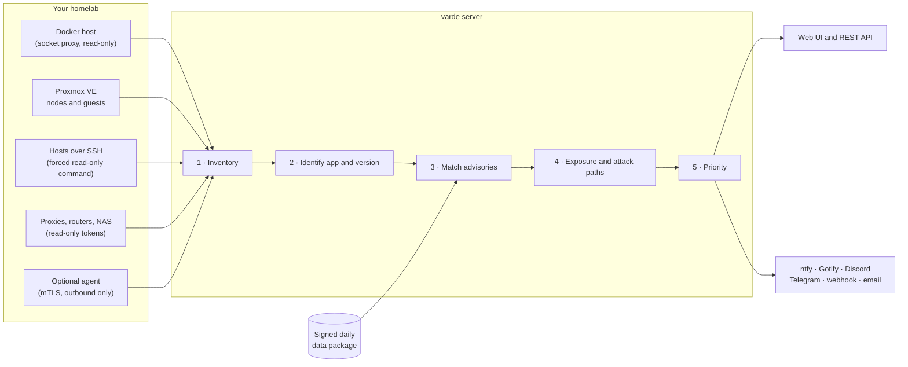
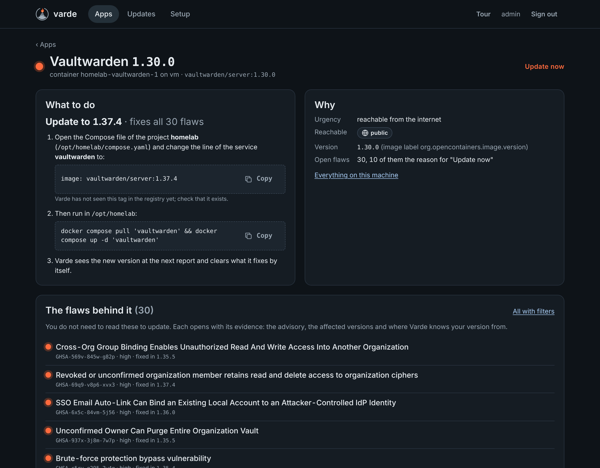

<p align="center">
  <picture>
    <source media="(prefers-color-scheme: dark)" srcset="assets/brand/lockup-dark.svg">
    
  </picture>
</p>

<h3 align="center">Lit only when it matters.</h3>

<p align="center">
  Security advisories for the self-hosted apps you actually run,<br>
  in the versions you actually run, with the one update that fixes them.
</p>

<p align="center">
  <a href="https://github.com/bifrost0x/varde/actions/workflows/ci.yml"></a>
  <a href="LICENSE"></a>
  <a href="go.mod"></a>
  <a href="https://github.com/bifrost0x/varde/pkgs/container/varde"></a>
  
</p>

<p align="center">
  <a href="#quick-start">Quick start</a> ·
  <a href="#how-it-works">How it works</a> ·
  <a href="#what-varde-sees">What Varde sees</a> ·
  <a href="#security">Security</a> ·
  <a href="#privacy">Privacy</a> ·
  <a href="#documentation">Documentation</a>
</p>

<p align="center">
  
</p>

> [!NOTE]
> **Pre-release.** The first release is in preparation. The image `ghcr.io/bifrost0x/varde:latest`
> follows the branch `main` until then; see the [roadmap](docs/roadmap.md) for what is still open.

## Why Varde

A *varde* was a signal fire on a hilltop in Viking-age Norway, lit to warn of approaching danger.
Lighting it without reason, or failing to light it when danger came, was punished. Varde follows
the same rule.

Image scanners answer "which CVEs are in this file system" and hand you hundreds of them. A homelab
asks something simpler:

> Is an app I run, in the exact version I run, affected by a published advisory, how urgently do I
> need to act, and what do I change?

Varde answers that question and nothing louder:

- **Apps, not CVE lists.** Each app that needs something gets one card: the version to install,
  why it matters, and for Compose services the line to change. The version is a release that
  exists, not just a number from an advisory.
- **Precision before recall.** Every version carries its evidence and a trust level. A version
  Varde is not sure about never alerts; an advisory it cannot compare is shown as "check
  yourself", never as "affected". Patched distribution packages with backported fixes count as
  patched.
- **Silent until it matters.** Only what is reachable or already exploited is pushed at once.
  The rest waits for a digest. When nothing is urgent, the beacon stays unlit.
- **No agent required.** Varde runs as one small container and finds the rest of your homelab
  through the official, read-only interfaces of the platforms you already use.
- **Your inventory stays home.** No account, no telemetry, no phone-home. Advisory data comes as
  one signed package that every installation downloads the same way.

## Quick start

A deployment is two containers: a read-only Docker socket proxy and Varde. Nothing in the Compose
file has to be changed to start.

```bash
mkdir varde && cd varde
curl -fsSLO https://raw.githubusercontent.com/bifrost0x/varde/main/deploy/compose.yaml
docker compose up -d
```

Read the one-time setup token (valid 24 hours):

```bash
docker compose logs varde | grep setup_token
```

On Windows use `findstr setup_token` instead of `grep`.

Open `http://<address of that machine>:8080` from any machine in your network, create the account
with the token, and follow the front page. It lists your containers with what each needs, offers a
short tour, and **Setup** walks you through allowing your networks, scanning them and connecting
what it found.

<details>
<summary><strong>HTTPS, pinning a version, machines reachable from the internet</strong></summary>

- **HTTPS.** Put a reverse proxy (Traefik, Caddy, Nginx Proxy Manager, ...) in front of port 8080
  and remove the `#` of the two lines the Compose file marks for it (`VARDE_BASE_URL`,
  `VARDE_BEHIND_TLS_PROXY`). From then on Varde only accepts sign-ins over the https address.
- **Pin a version.** Put it into a `.env` next to `compose.yaml`, for example
  `VARDE_VERSION=0.1.0`.
- **Internet-facing host.** Bind the UI to loopback (`"127.0.0.1:8080:8080"`) and reach it
  through the proxy only.
- **Agents.** Port 8443 only accepts agents' client certificates. Remove it from the file when you
  use no agents.
- **Everything else:** [configuration reference](docs/configuration.md), and
  [backup, restore and upgrades](docs/configuration.md#backup-restore-and-upgrades).

</details>

## How it works



1. **Inventory.** The local Docker host through a read-only socket proxy and, in the networks you
   allow, everything Varde can reach through a narrow credential. Docker events keep it current.
2. **Identification.** Each workload becomes an app (Immich, Vaultwarden, Jellyfin, nginx, ...)
   with a version, from labels, tags, the registry, the image's package databases and the app's
   own manifest or version endpoint. Floating tags such as `latest` are resolved through the
   registry; they never give a version on their own.
3. **Matching.** App advisories are matched with exact version ranges. Distribution packages are
   compared against their distribution's own security data in that distribution's version order.
4. **Assessment.** Exposure (public, LAN, internal) comes from reverse proxy routes, published
   ports and the network scan. Attack paths separate the flaw an attacker can reach from
   background noise behind it.
5. **Priority and notification.** Severity, CISA KEV, EPSS and exposure decide the priority.
   Varde notifies again only when a priority rises.

| Priority | On the page | Notified |
|---|---|---|
| P1 | **Update now**: reachable or already exploited | at once |
| P2 | **Update soon**: serious, but not directly reachable | daily digest |
| P3 | **Next update** | weekly digest |
| unverified | **Check yourself**: not comparable, never counted as affected | not notified |

Every app has a page with numbered steps (the Compose line, the commands), why it is urgent, where
the version came from, and the flaws behind it with their evidence. Findings keep their identity
across `docker compose up -d`, so the history shows what an update actually fixed.

<table>
  <tr>
    <td width="50%"></td>
    <td width="50%"></td>
  </tr>
  <tr>
    <td align="center"><sub>One app: what to change, and why</sub></td>
    <td align="center"><sub>All clear: the beacon stays unlit</sub></td>
  </tr>
</table>

## What Varde sees

### Without an agent

Everything below is optional, switched on per integration, and limited to the networks you allow.
Each setup flow names exactly what to create on the other side, checks the connection and pins the
certificate or host key.

| Source | How Varde reads it | What it yields |
|---|---|---|
| Local Docker | Socket proxy, GET requests only | Containers, images, settings, events |
| Network scan | Common homelab ports, optional SNMP | Devices and the services they announce |
| Proxmox VE | API token with `PVEAuditor` | Nodes, VMs, LXC containers and their addresses |
| Proxmox guests | One SSH key line on the node, forced command | Packages and Docker containers inside every guest |
| Docker over SSH | Key line limited to `docker system dial-stdio` | Containers of further Docker hosts |
| Packages over SSH | Key line with a fixed read-only command, no shell | dpkg, rpm and apk packages, services, kernel |
| Traefik, Nginx Proxy Manager | Read-only API user | Routes, and with them what is public |
| Fritz!Box, OPNsense, UniFi | User without rights, or a narrow API key | Devices on the LAN; UniFi firmware state |
| Synology DSM, QNAP, TrueNAS, Unraid, Home Assistant OS | Non-admin user or read-only key | System version, checked like any app |
| Web apps in the catalog | Documented version endpoint | Version, only when the answer proves its origin |

Details for each integration: [network discovery and integrations](docs/configuration.md#network-discovery-and-integrations).

### With the optional agent

For hosts Varde cannot reach, for example in another VLAN or behind a VPN. The agent connects
outbound over mTLS and needs no open port. Varde installs it with one SSH sign-in on up to 20
Linux hosts at once (systemd or OpenRC, amd64 or arm64), stores no credential, and updates it
automatically. See [agents](docs/configuration.md#agents) or run it by hand with
[`deploy/compose.agent.yaml`](deploy/compose.agent.yaml).

### Inside the images

Varde reads the package databases of container images and of hosts and checks them against the
distribution's security data: Debian, Ubuntu, Alpine, AlmaLinux, Rocky Linux, openSUSE Leap and
Tumbleweed, RHEL/UBI, Wolfi and Chainguard. App dependencies are read from Go build information,
npm lock files, Python, PHP Composer, Ruby gem, .NET and Maven metadata, and Rust programs built
with cargo-auditable.

### Recognition

A curated [catalog](catalog/apps/) of verified apps, appliances and infrastructure, plus a
first-party index of self-hosted images built from public app stores. Unknown images are listed
under **Gaps** and can be exported as a plain list for a catalog suggestion, without versions,
host names or private registries. Your own entries go into `VARDE_CATALOG_DIR`
([catalog guide](docs/catalog.md)).

## Where the advisories come from

| Mode | Sources | What others learn |
|---|---|---|
| **Data package** (default) | One signed package a day: project advisories, osv.dev and NVD records, CISA KEV, EPSS, release tags, catalog and index | The mirror sees that an installation fetches the package, not which apps it runs |
| **Direct** (`VARDE_MODE=direct`) | Varde asks GitHub, CISA and FIRST itself; osv.dev, NVD and endoflife.date are opt-in | GitHub learns which apps you run; each opt-in source says what it reveals |
| **Air-gapped** | The same package from a mounted directory or `.tar` (`file://`) | Nothing |

Every package is verified against the embedded trust root, with rollback and freeze protection.
If a package cannot be fetched, the last verified one stays in use and a notice appears; Varde never
falls back to asking public sources on its own. Details: [data package](docs/configuration.md#the-data-package),
[feed trust](docs/feed-trust.md).

Varde is complete without any service of the project. An optional paid feed (the
[uplink](docs/configuration.md#the-uplink-switch)) is planned; it supplies data, it never unlocks
features.

## Security

Varde knows your whole homelab, so it is built to be a boring target.

- **Read-only by design.** Docker only through a socket proxy that allows GET requests to a minimal
  set of endpoints; a directly mounted socket is refused by default. SSH keys run one forced
  command, API tokens are read-only, fingerprints are pinned, and nothing outside the allowed
  networks is contacted. Varde never changes anything on your hosts.
- **Hardened container.** Distroless static image, non-root (UID 65532), read-only root file
  system, all capabilities dropped, no shell.
- **No default credentials.** The first account needs a one-time token from the log. Passwords are
  hashed with argon2id; sessions and API tokens are stored only as hashes; integration secrets are
  encrypted at rest.
- **Web hardening.** Strict Content Security Policy without inline scripts or styles, CSRF tokens
  plus Fetch Metadata checks on every state-changing request, sign-in throttling, audit log.
- **Agents.** mTLS with a private CA and pinned client certificates; the agent port serves nothing
  else except enrollment.
- **Outbound.** One hardened HTTP client with timeouts, size limits, same-host redirects and an
  optional egress allowlist.
- **Supply chain.** Pure Go, standard library first, every dependency justified in
  [docs/dependencies.md](docs/dependencies.md); CI runs tests with the race detector, golangci-lint,
  govulncheck, CodeQL and fuzzing.

[Threat model](docs/threat-model.md) · [Security review](docs/security-review.md) ·
Report vulnerabilities privately as described in [SECURITY.md](SECURITY.md).

## Privacy

Your inventory never leaves your network. Varde downloads the same public data every installation
downloads and matches locally. There is no telemetry, no account and no phone-home. Outbound
requests carry a fixed User-Agent without installation data. The Gaps export is a file for you to
attach, not something Varde sends.

## Notifications

Urgent findings are pushed at once, the rest goes into a daily or weekly digest at the hour you
choose. Channels: **ntfy**, **Gotify**, **Discord**, **Telegram**, **email** (SMTP with STARTTLS or
TLS), and a **webhook** with optional HMAC signature. They are configured through environment
variables, so their secrets never pass through the UI
([configuration](docs/configuration.md)).

## Integrate

- **REST API** with scoped tokens: [OpenAPI 3.1](docs/api/openapi.yaml).
- **OpenVEX** export of all findings: `GET /api/v1/vex`.
- **Prometheus metrics** at `/metrics` (authenticated), health at `/healthz` and `/readyz`.

## What Varde does not do

- Scan every file of an image. It reads package databases and app metadata; for a full image scan
  use Trivy or Grype.
- Change anything on your hosts or update containers for you.
- Analyse traffic, or see router port forwards and firewalls.
- Need a cloud account.

Known limitations are listed in the [roadmap](docs/roadmap.md#known-limitations).

## Command line

The binary in the image is `/varde`:

| Command | Purpose |
|---|---|
| `server` | Run the server |
| `agent` | Run the agent |
| `backup <file>` | Consistent backup of the data directory while running |
| `restore <file>` | Restore into an empty data directory |
| `reset-password <user>` | Set a new random password |
| `check-server` | Test from an agent host whether the server's agent port is reachable |
| `healthcheck` | Container health check |
| `version` | Print the version |

```bash
docker exec varde /varde backup /data/varde-backup.tar
```

## Build from source

Requirements: Go (version in [`go.mod`](go.mod)), `make`, Docker for the image.

```bash
make build     # bin/varde, static, CGO off
make run-dev   # local server on 127.0.0.1:8080
make check     # license headers, lint, tests with -race, govulncheck
make image     # container image
make eval      # recognition measurement against the test corpus
```

## Documentation

| Running Varde | How it is built | The project |
|---|---|---|
| [Configuration](docs/configuration.md) | [Architecture](docs/architecture.md) | [Roadmap](docs/roadmap.md) |
| [Data package](docs/data-package.md) | [Architecture decisions](docs/adr/) | [Changelog](CHANGELOG.md) |
| [Feed trust](docs/feed-trust.md) | [Threat model](docs/threat-model.md) | [Contributing](CONTRIBUTING.md) |
| [REST API](docs/api/openapi.yaml) | [Security review](docs/security-review.md) | [Catalog guide](docs/catalog.md) |
| [Backup and upgrades](docs/configuration.md#backup-restore-and-upgrades) | [Performance](docs/performance.md) | [Releasing](docs/releasing.md) |
| | [Dependencies](docs/dependencies.md) | [Brand](docs/brand.md) |

## Contributing

Catalog entries are the easiest way to help: every one is verified against the live project and
comes with a test case. Start with the [catalog guide](docs/catalog.md) or open a
[catalog request](https://github.com/bifrost0x/varde/issues/new?template=catalog.yml). Code
changes follow [CONTRIBUTING.md](CONTRIBUTING.md); precision beats recall, and changes that raise
alert volume need a strong argument and tests.

## License

Apache-2.0, code and catalog data alike. See [LICENSE](LICENSE) and [NOTICE](NOTICE).
