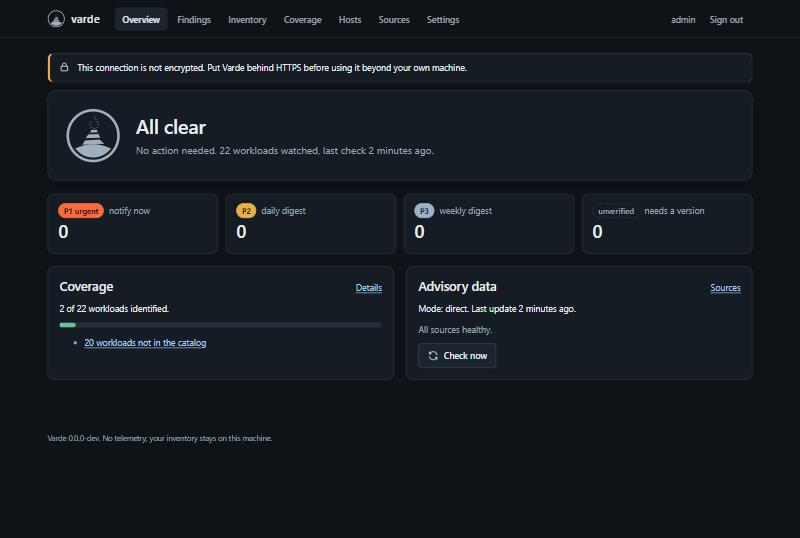
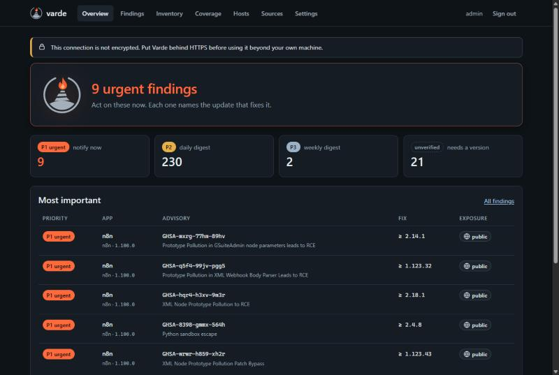

  <picture>
    <source media="(prefers-color-scheme: dark)" srcset="assets/brand/lockup-dark.svg">
    
  </picture>

<strong>Lit only when it matters.</strong>

  Security advisories for the self-hosted apps you actually run, in the versions you actually run.

---

> **Status: pre-release.** The first release is in preparation; see the
> [roadmap](docs/roadmap.md) for what is missing.

A *varde* was a signal fire on a hilltop in Viking-age Norway, lit to warn of approaching danger.
Lighting it without reason, or failing to light it when danger came, was punished. Varde follows
the same rule: silent until a real threat to something you actually run appears, then impossible to
miss.

## What it does

Varde runs as a small container in your homelab and answers one question:

> Is an app I am running, in the exact version I am running, affected by a published security
> advisory, and how urgently do I need to act?

1. Finds what runs: the local Docker host through a read-only socket proxy, and, in the networks
   you allow, Proxmox VE nodes and their guests, further Docker hosts over SSH, native packages over
   SSH and common homelab services, each through one narrow, read-only credential. No agent is
   needed; the agent stays an option for hosts Varde cannot reach.
2. Identifies the app behind each workload (Immich, Vaultwarden, Jellyfin, nginx, ...) and its
   version, from labels, tags, the registry, the image's packages and the app's own manifest. Every
   version carries its evidence; a doubtful one never alerts.
3. Matches against app-level advisories. Distribution packages (Debian, Ubuntu, Alpine, AlmaLinux,
   Rocky Linux, openSUSE Leap) are checked against their distribution's own security data, so
   backported fixes count.
4. Estimates exposure (public, LAN or internal) and prioritises with severity, CISA KEV, EPSS and
   exposure.
5. Stays silent unless something is relevant. Urgent findings are pushed immediately (ntfy,
   Gotify, Discord, Telegram, webhook, email), the rest goes into a digest. Every finding names the
   concrete update: the release tag that fixes it and, for Compose services, the line to change.
6. Exports what it knows as OpenVEX.

What it does not do: scan base-image OS packages for CVEs (use Trivy or Grype for that), change
anything on your hosts, automatic updates, traffic analysis, or anything that needs a cloud
account.

  

  

## Quick start

A deployment is two containers, a read-only Docker socket proxy and Varde:

1. Download [`deploy/compose.yaml`](deploy/compose.yaml) into an empty directory and create a
   `.env` next to it with the release to run, for example `VARDE_VERSION=0.1.0`. Set
   `VARDE_HOST_ADDRESS` in the file to this machine's address in your network, and `TZ` for the
   digest time.
2. `docker compose up -d`, then read the one-time setup token:
   `docker compose logs varde | grep setup_token` (on Windows: `findstr setup_token`).
3. Open `http://127.0.0.1:8080` on that machine, create the account with the token and follow the
   overview: it offers a short tour, and Connections walks you through allowing your networks,
   scanning and connecting what it found. For the full inventory of a host, Varde installs its
   agent there with one SSH sign-in (it can also run by hand, see
   [`deploy/compose.agent.yaml`](deploy/compose.agent.yaml)).
4. To use Varde from other machines, put a TLS reverse proxy in front of port 8080; the agent port
   8443 is published directly and only accepts agents' client certificates.

Backups, restores and upgrades: [`docs/configuration.md`](docs/configuration.md#backup-restore-and-upgrades).

## Security model

- Docker access only through a socket proxy that allows GET requests to a minimal set of endpoints.
  Varde refuses a directly mounted Docker socket by default.
- Agentless connections are read-only and narrow: SSH keys restricted to one forced command,
  read-only API tokens, TLS fingerprints pinned, and only to the networks you allowed.
- Hardened image: distroless static, non-root (UID 65532), read-only root filesystem, no
  capabilities, no shell.
- No default credentials. First login requires a one-time setup token printed to the log.
  Passwords are hashed with argon2id; sessions and API tokens are stored only as hashes.
- Strict Content Security Policy without inline scripts or styles; CSRF tokens plus fetch
  metadata checks on every state-changing request.
- Advisory data from the central feed is signed and protected against rollback and freeze attacks.
- Details: [docs/threat-model.md](docs/threat-model.md). Report vulnerabilities as described in
  [SECURITY.md](SECURITY.md).

## Privacy

Your inventory never leaves your network. Varde downloads the same public data everyone downloads
and matches locally. There is no telemetry, no account and no phone-home.

In direct mode, Varde queries upstream sources such as the GitHub advisory API itself, which reveals
to those services which apps you run. Sources that reveal more (osv.dev with package names and
releases, the NVD, endoflife.date, the image registries) are off until you switch them on, and
each says what it reveals. Feed mode avoids this and becomes the default once the central feed is
available.

## Documentation

- [Roadmap](docs/roadmap.md)
- [Architecture decisions](docs/adr/)
- [Threat model](docs/threat-model.md)
- [Configuration](docs/configuration.md)
- [Feed trust](docs/feed-trust.md)
- [Architecture](docs/architecture.md)
- [Performance](docs/performance.md)
- [Releasing](docs/releasing.md)
- [Security review](docs/security-review.md)
- [REST API (OpenAPI 3.1)](docs/api/openapi.yaml)
- [Brand](docs/brand.md)
- [Contributing](CONTRIBUTING.md)

## License

Apache-2.0. See [LICENSE](LICENSE) and [NOTICE](NOTICE).
